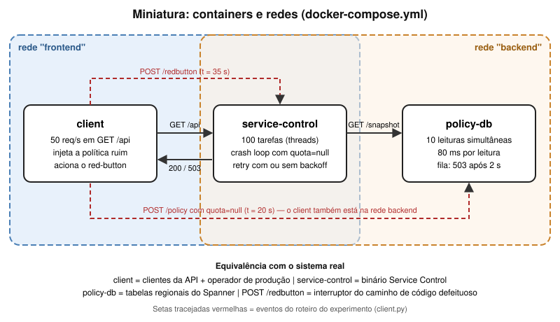

# Miniatura do incidente Google Cloud (12/06/2025)

## Artigo de origem

**O que é:** relatório oficial do incidente do Google Cloud de 12 de junho de 2025 no Service Control. Uma política de cota com campos em branco foi gravada nas tabelas regionais do Spanner e replicada globalmente em segundos. Os binários do Service Control rodavam código novo sem tratamento de erro e sem feature flag: ao ler a política, caíram num null pointer e entraram em crash loop em todas as regiões.

Quando o red-button (que desliga o caminho de código defeituoso) foi aplicado, as tarefas das regiões grandes reiniciaram todas juntas, sem backoff exponencial aleatório. Isso causou um efeito manada (thundering herd) no Spanner e prolongou a recuperação de us-central1 (até ~2h40).

**Fonte oficial:** https://status.cloud.google.com/incidents/ow5i3PPK96RduMcb1SsW

**Objetivo:** reproduzir esse mecanismo em miniatura, medir tempo até a falha, tempo até a recuperação e % de requisições com erro, comparar com o artigo e medir uma mitigação (backoff exponencial com jitter) antes e depois. O laudo está em [`docs/laudo.md`](docs/laudo.md).

---

## Requisitos

- Docker Desktop com Docker Compose v2
- Python 3 no host (só para `analyze.py` e `summarize.py`; sem dependências externas)
- Shell bash: Linux, macOS, ou **Git Bash / WSL no Windows**. O `run.sh` usa `python3` ou, se não existir, `python`.

---

## Para o professor reproduzir (passo a passo)

```bash
# 1) Clonar e entrar na pasta
git clone https://github.com/ildevdio/CasoGoogleRecriacaoFCCPD
cd CasoGoogleRecriacaoFCCPD

# 2) Reproduzir a falha SEM mitigação (~3 min)
./run.sh none prof

# 3) Mesma falha COM a mitigação (backoff exponencial com jitter, ~2 min)
./run.sh jitter prof

# 4) (opcional) backoff exponencial sem jitter
./run.sh exp prof
```

Usar `prof` como repetição grava em `logs/none_runprof/`, `logs/jitter_runprof/` etc. Assim **não sobrescreve** as execuções citadas no laudo (`logs/<modo>_run1..3/`) e não entra no `logs/summary.txt`.

**O que conferir:** em `logs/none_runprof/metrics.txt`, o pico de fila no banco depois do red-button (`pico_fila_no_db_pos_red-button`) fica bem acima do pico no crash loop, e há leituras rejeitadas. É o efeito manada. Em `logs/jitter_runprof/metrics.txt`, a recuperação e a fila caem. Os valores variam entre execuções; as medianas do laudo estão em `logs/summary.txt`.

Para as execuções do laudo usamos `./run.sh <modo> 1`, `2` e `3` para cada modo. Rodar de novo com esses números **sobrescreve** os logs entregues.

---

## Estrutura do repositório

```
docker-compose.yml   # 3 containers e 2 redes
Dockerfile           # imagem Python 3.12-slim com app/
app/
  db.py              # policy-db       = tabelas regionais do Spanner (capacidade limitada)
  service_control.py # service-control = binario Service Control (N tarefas em threads)
  client.py          # client          = trafego de API + operador (injeta politica, red-button)
run.sh               # ./run.sh none|exp|jitter <repeticao>
analyze.py           # metricas de UMA execucao -> logs/<modo>_run<N>/metrics.txt
summarize.py         # medianas de todas as execucoes -> logs/summary.txt
IA.md                # registro de uso de IA (prompts e erros corrigidos)
docs/
  laudo.md                # laudo tecnico (Partes A-D), fonte do PDF
  laudo.pdf               # laudo entregue (gerado por gerar_pdf.py)
  gerar_pdf.py            # laudo.md -> laudo.pdf (pip install markdown; usa Edge/Chrome headless)
  diagrama_miniatura.svg  # diagrama de containers e redes (e .png)
logs/
  none_run1..3/  exp_run1..3/  jitter_run1..3/   # execucoes citadas no laudo
  summary.txt                                    # medianas + arquivo de origem de cada numero
  parte_d_apimanuali/put_parcial.log             # teste do projeto da equipe (Parte D)
  v1/                                            # primeira rodada (antes das correcoes; citada na surpresa e no IA.md)
```

---

## Arquitetura da miniatura



| Container | Representa no sistema real |
|-----------|----------------------------|
| `policy-db` | Tabela regional do Spanner com as políticas de cota: 10 leituras simultâneas, 80 ms cada, 503 após 2 s na fila |
| `service-control` | Binário Service Control: 100 tarefas que leem a política, entram em crash loop com `quota=null` e reiniciam conforme o modo |
| `client` | Clientes da API (50 req/s em `/api`; cada requisição cai numa tarefa sorteada) e operador (injeta a política ruim e aciona o red-button) |

---

## Modos (`MITIGATION`)

| Modo | Retry de leitura no warmup | Reinício após crash | Papel no experimento |
|------|---------------------------|---------------------|----------------------|
| `none` | 0,01 s fixo | `RESTART` fixo (0,5 s) | Reproduz o incidente: sem backoff |
| `exp` | `min(CAP, BASE·2ⁿ)` | `min(CAP, RESTART·2ⁿ)` | Backoff exponencial **sem** jitter |
| `jitter` | sorteio uniforme em `[0, min(CAP, BASE·2ⁿ)]` | sorteio uniforme em `[0, min(CAP, RESTART·2ⁿ)]` | Mitigação: backoff exponencial **com** jitter |

Implementação: função `wait_time()` em `app/service_control.py`.

---

## Linha do tempo de uma execução

- **t = 0 s**: sistema saudável (100 tarefas prontas), 50 req/s em `/api`.
- **t = 20 s**: o `client` grava a política com `quota: null` no `policy-db`. Cada tarefa que lê a política cai em crash loop; requisições que caem numa tarefa fora do ar recebem 503.
- **t = 35 s**: red-button. As tarefas reiniciam e releem o banco. No modo `none` elas chegam todas juntas e o banco enfileira e rejeita leituras (efeito manada); com `jitter` o reinício se espalha no tempo.
- **Fim**: quando 90% das tarefas ficam prontas por 20 s seguidos **e** a janela de 60 s após a política ruim terminou; ou no teto `MAX_S` (240 s).

---

## Logs e métricas

Cada execução cria `logs/<modo>_run<N>/`:

| Arquivo | Conteúdo |
|---------|----------|
| `compose_stdout.log` | saída bruta do Docker Compose |
| `client.csv` | cada requisição (epoch, status, latency_ms) |
| `client_events.log` | instantes de início, política ruim, red-button, estabilidade e fim |
| `sc.log` | service-control: `task_ready`, `task_crash`, `ready_count` por segundo |
| `db.log` | policy-db: leituras ok, rejeitadas e em fila por segundo |
| `metrics.txt` | métricas do `analyze.py`, cada uma com o arquivo de origem |

Métricas do `analyze.py`:
- tempo até a falha (política ruim → 1º erro) e até a recuperação (red-button → último erro)
- razão recuperação ÷ tempo até o red-button (para comparar com o caso real)
- % de erro antes da falha, entre a falha e o red-button, depois do red-button e numa **janela fixa de 60 s** após a falha
- tempo até 10%, 50% e 90% das tarefas prontas após o red-button; tarefas prontas no fim
- pico de fila e de leituras rejeitadas no banco, **separados entre crash loop e pós-red-button**

`summarize.py` (rodado pelo `run.sh` no final) junta todas as execuções `logs/<modo>_run<N>/` e grava `logs/summary.txt` com a mediana de cada métrica e o arquivo de onde ela saiu. Todo número do laudo foi tirado desse arquivo.

---

## Parâmetros (opcional)

Variáveis de ambiente lidas pelo `docker-compose.yml`:

| Variável | Padrão | Descrição |
|----------|--------|-----------|
| `MITIGATION` | `none` | `none`, `exp` ou `jitter` (o `run.sh` define pelo 1º argumento) |
| `N_TASKS` | `100` | tarefas do service-control |
| `DB_CAPACITY` | `10` | leituras simultâneas no banco |
| `DB_COST_MS` | `80` | custo de cada leitura (ms) |
| `DB_QUEUE_TIMEOUT_S` | `2` | tempo máximo na fila do banco antes do 503 |
| `WARMUP_READS` | `5` | leituras boas para uma tarefa ficar pronta |
| `POISON_AT_S` | `20` | instante da política ruim |
| `REDBUTTON_AT_S` | `35` | instante do red-button |
| `STABLE_S` | `20` | segundos seguidos com `READY_FRAC` das tarefas prontas para encerrar |
| `READY_FRAC` | `0.9` | fração de tarefas prontas considerada recuperada |
| `WINDOW_S` | `60` | janela fixa da % de erro (o `analyze.py` também lê essa variável) |
| `MAX_S` | `240` | duração máxima da execução |

Exemplo: `N_TASKS=20 ./run.sh none prof`
