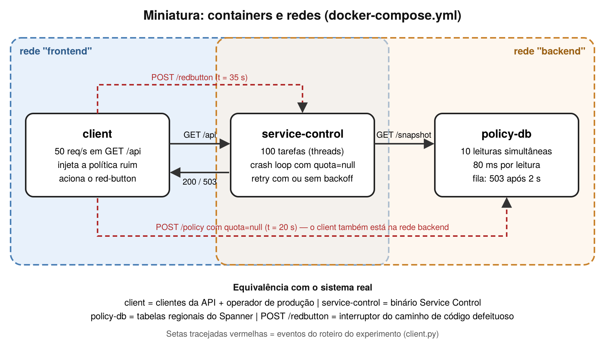

# Laudo de Incidente Reproduzido — Google Cloud, 12/jun/2025

Equipe: SRE da disciplina | Repositório: https://github.com/ildevdio/CasoGoogleRecriacaoFCCPD | Fonte: https://status.cloud.google.com/incidents/ow5i3PPK96RduMcb1SsW (horários em US/Pacific)

Convenção: todo número medido indica o arquivo de `logs/` de onde saiu. As medianas de 3 execuções estão em `logs/summary.txt` (gerado por `summarize.py`), que aponta para o `metrics.txt` da execução do meio. Números do caso real indicam a seção do artigo.

---

## Parte A — O mecanismo

**Em uma frase:** uma política de cota com campos em branco foi replicada para todas as regiões em segundos e derrubou o Service Control em crash loop; quando o red-button foi acionado, as tarefas das regiões grandes reiniciaram todas juntas, sem backoff exponencial aleatório, e sobrecarregaram o Spanner — um **efeito manada** que atrasou a recuperação de us-central1.

**Linha do tempo**

| # | Quando | Evento | Onde no artigo |
|---|--------|--------|----------------|
| 1 | 29/05/2025 | Nova verificação de cota entra no Service Control sem tratamento de erro e sem feature flag; o rollout por região não exercita o caminho defeituoso | Incident Report › *What happened?*, 2º parágrafo |
| 2 | 12/06, ~10:45 | Política com campos em branco é gravada no Spanner regional e replicada globalmente em segundos; o null pointer põe os binários em crash loop em todas as regiões | *What happened?*, 3º parágrafo (Mini Incident Report: início 10:49) |
| 3 | +2 / +10 / +25 min | SRE em triagem; causa raiz identificada; red-button pronto para rollout | *What happened?*, 4º parágrafo |
| 4 | +40 min | Rollout do red-button concluído; recuperação começa pelas regiões menores | *What happened?*, 4º parágrafo |
| 5 | após o red-button | Em us-central1 o reinício das tarefas causa efeito manada no Spanner por falta de backoff exponencial aleatório; Google limita a criação de tarefas e desvia tráfego para bancos multirregionais; até ~2h40 para resolver | *What happened?*, 5º parágrafo |
| 6 | 12:48 / 13:49 | Todas as regiões exceto us-central1 mitigadas; fim do incidente | Mini Incident Report (o cabeçalho da página marca fim às 18:18 por impacto residual em Dataflow e Vertex AI) |

**Conceito da disciplina: efeito manada (thundering herd).** É esse o conceito porque a queda prolongada não veio do dado ruim em si — o red-button o neutralizou em 40 minutos —, mas de muitos clientes idênticos (as tarefas do Service Control) disputando o mesmo recurso (a tabela do Spanner) no mesmo instante, todos com o mesmo comportamento de retry. O artigo nomeia o fenômeno (*herd effect*) e a causa: as tarefas *did not have the appropriate randomized exponential backoff implemented* (5º parágrafo). A mitigação clássica do efeito manada — espalhar as tentativas no tempo com backoff e jitter — é exatamente a que o artigo lista entre as ações futuras.

**Conceito associado: acoplamento / ponto único de falha.** Todas as regiões consumiam a mesma política replicada globalmente, sem rollout em ondas: um único dado inválido derrubou todas ao mesmo tempo (3º parágrafo). Esse acoplamento é o *gatilho*; o efeito manada é o que *prolonga* o incidente.

---

## Parte B — A miniatura



| Container | Representa no sistema real |
|-----------|----------------------------|
| `policy-db` | Tabela regional do Spanner com as políticas de cota: capacidade limitada (10 leituras simultâneas, 80 ms cada, rejeição com 503 após 2 s na fila) |
| `service-control` | Binário Service Control: 100 tarefas (threads) que leem a política, entram em crash loop com `quota=null` e reiniciam conforme o modo (`none`, `exp`, `jitter`) |
| `client` | Clientes da API (50 req/s em `/api`, cada requisição cai numa tarefa sorteada) e o operador de produção (injeta a política ruim em t=20 s e aciona o red-button em t=35 s) |

Redes: `frontend` (client ↔ service-control) e `backend` (service-control ↔ policy-db). O `client` também está no `backend` para injetar a política, como o processo automático que gravou a política no Spanner.

**O que a miniatura não reproduz**

| Ponto real não reproduzido | Efeito nas conclusões |
|---------------------------|----------------------|
| Várias regiões com tamanhos diferentes (há uma só "região" com 100 tarefas) | Não mostramos que regiões pequenas voltam primeiro e us-central1 por último. A conclusão vale para *uma* região grande; não medimos como o tamanho da região muda o efeito. |
| Spanner real (réplicas, autoscaling, isolamento por tabela); aqui o banco é um semáforo com custo fixo | Os tempos absolutos não são comparáveis. Comparamos só proporções (Parte C) e a forma da curva (fila e rejeições antes e depois do red-button). |
| Ações manuais da Google em us-central1 (limitar criação de tarefas, desviar para bancos multirregionais) | No modo `none` ninguém intervém, então a recuperação da miniatura é o pior caso "sem operador". Isso tende a deixar a miniatura mais lenta que o real, em proporção. |
| Queda da própria página de status e do monitoramento (seção *How did we communicate?*) | Não medimos impacto na comunicação. O tempo até detectar a falha é instantâneo na miniatura, o que subestima o tempo até o red-button no caso real. |

---

## Parte C — O experimento

Roteiro de cada execução (`./run.sh <modo> <n>`): sistema estável → política com `quota=null` em t=20 s → red-button em t=35 s → execução termina quando 90% das tarefas ficam prontas por 20 s seguidos (teto de 240 s). Foram 3 execuções por modo. Aqui comparamos o modo **sem mitigação (`none`)** com o caso real; a mitigação está na Parte D.

| Métrica | Miniatura (`none`, mediana) | Arquivo | Caso real | Onde no artigo |
|---------|-----------------------------|---------|-----------|----------------|
| Tempo até a falha (política ruim → 1º erro) | 0,13 s | `logs/none_run2/metrics.txt` | segundos (replicação global quase instantânea) | 3º parágrafo |
| % de erro entre a falha e o red-button | 92,53% | `logs/none_run3/metrics.txt` | não informado (crash loop em todas as regiões) | 3º parágrafo |
| Tempo da falha até o red-button | 15,07 s | `logs/none_run3/metrics.txt` | ~40 min | 4º parágrafo |
| Tempo até a recuperação (red-button → último erro) | 63,49 s | `logs/none_run1/metrics.txt` | us-central1: até ~2h40 | 5º parágrafo |
| **Recuperação ÷ tempo até o red-button** | **4,26** | `logs/none_run1/metrics.txt` | **3 a 4** (ver abaixo) | 4º e 5º parágrafos |
| % de erro na janela fixa de 60 s após a falha | 84,97% | `logs/none_run1/metrics.txt` | não informado | — |
| Pico de fila no banco: crash loop → após red-button | 31 → 388 | `logs/none_run1/metrics.txt` | sobrecarga do Spanner na recuperação | 5º parágrafo |
| Leituras rejeitadas/s: crash loop → após red-button | 0 → 83 | `logs/none_run2/metrics.txt` (0), `logs/none_run3/metrics.txt` (83) | idem | 5º parágrafo |

**Comparação com o artigo.** Escalas absolutas não se comparam (segundos contra horas), então comparamos a proporção entre o tempo de recuperação e o tempo até o red-button. No caso real, o red-button terminou em ~40 min, e us-central1 levou "até ~2h40" para se resolver. O artigo não diz se as 2h40 contam a partir do início do incidente ou do red-button, então a proporção real fica entre 3 (2h00 ÷ 40 min) e 4 (2h40 ÷ 40 min). A miniatura deu 4,26 na mediana (2,98 a 4,92 nas três execuções, `logs/summary.txt`). **A ordem de grandeza bate:** nos dois casos, recuperar levou várias vezes mais do que derrubar e decidir o conserto. O padrão também bate: o banco aguenta o crash loop (fila 31, nenhuma rejeição) e só cai *depois* do red-button (fila 388, 83 rejeições/s). Isso confirma que o problema foi o reinício em massa, como no 5º parágrafo do artigo.

**O que saiu diferente do esperado.** Na primeira rodada (`logs/v1/`), o laudo declarava o sistema recuperado em cerca de 4 s, mas a capacidade não tinha voltado: em `logs/v1/none_run2/sc.log` (última linha) a execução termina com `ready_count=50`, ou seja, metade das tarefas fora, e mesmo assim o `client_events.log` registra `stable_reached` e o `metrics.txt` informa recuperação de 3,91 s. **Explicação encontrada:** o `/api` respondia 200 sempre que *alguma* tarefa estava pronta, e o cliente considerava o sistema estável após 20 s sem erro. Com uma tarefa viva em 100, a métrica dizia "tudo certo". Corrigimos o `/api` para sortear entre todas as 100 tarefas, falhando se a sorteada não estiver pronta, como um balanceador real, e o critério de parada passou a ser 90% das tarefas prontas. Com isso a recuperação real do modo `none` apareceu: 63,49 s, e não ~4 s. A lição vale para o parecer: um health check otimista esconde exatamente a perda de capacidade que caracteriza o incidente.

---

## Parte D — Parecer para a diretora

**Pode acontecer com o nosso projeto (APIManuali, marketplace de artesanato)? Sim, em parte.** O gatilho do incidente, campos em branco aceitos e propagados sem aviso, já existe hoje e foi reproduzido. O efeito manada ainda não, porque a API guarda o estado em memória. Ele passa a ser um risco concreto quando a API migrar para o PostgreSQL, que o projeto já está preparando.

**1. Campos em branco (existe hoje, reproduzido).** `src/routes/products.js:38-53` (schema do PUT) e `src/services/ProductService.js:56-64` (`atualizar`):

```js
// products.js – atualizar: só nome, preco, estoque e ativo são obrigatórios
categoria: { type: 'string', required: false, max: 100 },
// ProductService.js – atualizar: sobrescreve tudo, mesmo o que não veio no PUT
product.categoria = dto.categoria;
product.descricao = dto.descricao;
product.historia  = dto.historia;
```

Em `logs/parte_d_apimanuali/put_parcial.log`, um produto com `"categoria":"Ceramica"` recebe um PUT só com os campos obrigatórios. Ele volta com `"categoria":""`, `"descricao":" "` e `"historia":""`, e passa a não aparecer no filtro `?categoria=Ceramica` (resposta `[]`). Nenhum erro é registrado. É o mesmo mecanismo do 3º parágrafo do artigo: um dado com campos em branco é aceito e espalhado para todos os leitores, aqui listagem, filtros e recomendações. **Defesa que já temos:** um PUT sem `nome` é rejeitado com erro de validação (mesmo log). Foi esse tipo de validação que faltou ao Google.

**2. Health check que não verifica nada (existe hoje).** `src/app.js:59-61`:

```js
app.get('/health', (req, res) => {
  res.json({ status: 'ok', timestamp: new Date().toISOString() });
});
```

É o mesmo defeito da nossa surpresa (Parte C): o sistema responde "ok" sem olhar a capacidade real nem as dependências. O CI (`.github/workflows/ci.yml:90-96`) usa esse endpoint para aprovar a API.

**3. Efeito manada (risco com a migração).** `src/utils/serialQueue.js:1-11`, usado por `reservarEstoque` em `src/services/ProductService.js:95-126`, é **uma fila única global, sem limite de tamanho**, que atende os pedidos de todos os produtos. Hoje cada tarefa da fila é síncrona e rápida, então nada se acumula. Quando `reservarEstoque` passar a esperar o banco, essa fila e o PostgreSQL viram o recurso compartilhado que o Spanner foi no incidente. A string de conexão (`.env.example:5`) não define `connection_limit`, e nenhuma chamada ao banco tem retry com backoff. Várias instâncias reiniciando juntas depois de uma falha repetiriam o 5º parágrafo do artigo.

**Mitigação implementada e medida na miniatura: backoff exponencial com jitter no reinício das tarefas** (`MITIGATION=jitter`, em `app/service_control.py`, função `wait_time`). Medimos também o backoff exponencial *sem* jitter (`exp`), para separar os dois efeitos. Medianas de 3 execuções:

| Métrica | Antes: `none` | `exp` (sem jitter) | Depois: `jitter` |
|---------|--------------|--------------------|-------------------|
| Tempo até a recuperação após o red-button | 63,49 s (`none_run1`) | 7,99 s (`exp_run1`) | 4,59 s (`jitter_run2`) |
| Tempo até 90% das tarefas prontas | 63,6 s (`none_run1`) | 8,6 s (`exp_run3`) | 4,9 s (`jitter_run2`) |
| % de erro na janela fixa de 60 s | 84,97% (`none_run1`) | 33,04% (`exp_run3`) | 27,43% (`jitter_run2`) |
| % de erro após o red-button | 55,60% (`none_run1`) | 12,91% (`exp_run3`) | 5,49% (`jitter_run2`) |
| Pico de fila no banco após o red-button | 388 (`none_run1`) | 59 (`exp_run3`) | 26 (`jitter_run2`) |
| Leituras rejeitadas/s após o red-button | 83 (`none_run3`) | 0 (`exp_run2`) | 0 (`jitter_run2`) |
| % de erro entre a falha e o red-button | 92,53% (`none_run3`) | 92,13% (`exp_run3`) | 92,67% (`jitter_run2`) |

Arquivos: `logs/<execução>/metrics.txt`. Fonte das medianas: `logs/summary.txt`.

**Leitura.** O backoff faz a maior parte do ganho e o jitter completa: a recuperação cai de 63,49 s para 7,99 s com `exp` e para 4,59 s com `jitter`, e a fila no banco cai de 388 para 59 e depois para 26. A última linha mostra o limite da mitigação: **o erro durante a queda não muda** (~92% nos três modos). Backoff não impede a falha. Ele só impede que a recuperação vire um segundo incidente. Contra a queda, a defesa é validar o dado antes de propagá-lo.

**Recomendações para o APIManuali, em ordem:** (1) no `atualizar`, manter o valor atual quando o campo vier `undefined` ou vazio, ou tratar como PATCH explícito; (2) fazer o `/health` verificar as dependências e expor um `/ready` com a capacidade real; (3) na migração para o PostgreSQL, usar retry com backoff exponencial e jitter na conexão e no `reservarEstoque`, com `connection_limit` definido. Os números acima mostram o efeito que se pode esperar.
